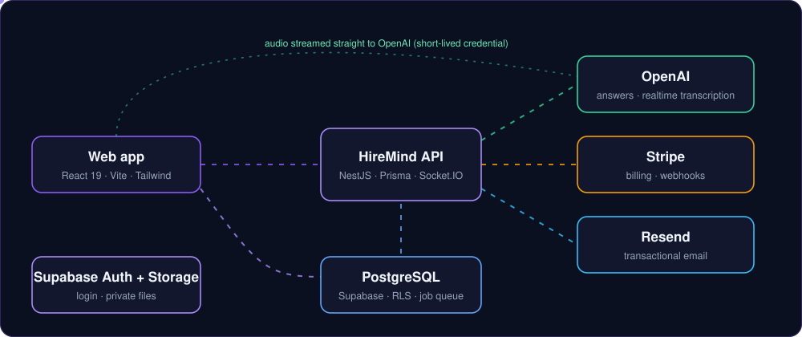

<div align="center">



<br/>

[](https://github.com/JusticeTechSystem/HireMind/actions/workflows/ci.yml)


**Prepare with mock interviews and coding practice, then get live transcription and answers grounded in your own resume.**

[Features](#features) · [Architecture](#architecture) · [Quick start](#quick-start) · [Scripts](#scripts) · [Docs](#documentation) · [Status](#project-status)


</div>

## Features

| | |
|---|---|
| 🎙️ **Live interview workspace** | Separate pipelines for microphone and shared-tab audio, streaming transcription, automatic question detection and answers in seven styles. |
| 📄 **Resume-aware answers** | Upload a PDF or DOCX. Answers cite experience that is really in your resume, and anything else is labelled a *suggested example*, never your own history. |
| 🧪 **Mock interviews** | Questions by role, level and difficulty, a timed session, and scoring on relevance, correctness, completeness, clarity, communication and structure. |
| 💻 **Coding and system design** | Solutions with approach, complexity, edge cases and tests in nine languages (code is never executed), plus architecture write-ups with diagrams. |
| 📊 **History and analytics** | Searchable sessions, AI summaries, PDF export and progress charts computed from your own data. |
| 🔐 **Privacy by design** | Raw audio is never stored, with explicit consent prompts. You can set transcript retention, export your data, revoke devices and delete your account. |
| 💳 **Plans and billing** | Free, Pro and Premium with server-enforced limits, Stripe checkout, portal, refunds and signed webhooks. |
| 🛠️ **Admin console** | Role-based access, moderation, AI usage and cost monitoring, support desk, announcements and an audit log. |


## Architecture

<div align="center"></div>

- **Monorepo (pnpm):** `apps/web` (React), `apps/api` (NestJS), `packages/*` (shared config, types and validation schemas), `prisma/` (schema, migrations, seeds).
- **Security model:** Supabase issues the login token, and the API verifies it and enforces roles and ownership on every query. Secrets stay on the server, and the browser only gets a short-lived transcription credential.
- **Reliability:** a Postgres-backed job queue, circuit breaker and retries on AI calls, idempotency keys on sensitive actions, structured JSON logs and Sentry hooks.

More detail: [`docs/architecture.md`](docs/architecture.md).

## Quick start

**Requirements:** Node 22, pnpm 9, Docker.

```bash
cp .env.example .env           # set at least JWT_SECRET (32+ chars)
docker compose up -d           # PostgreSQL + Redis
pnpm install
pnpm --filter "./packages/*" build
pnpm db:deploy                 # apply migrations
pnpm db:seed                   # roles and plans
pnpm dev:api                   # http://localhost:3000/api/docs
pnpm dev:web                   # http://localhost:5173
```

<details>
<summary><b>Connect the real services</b> (needed for login, AI, billing and email)</summary>

| Service | What it powers | Where to set it |
|---|---|---|
| Supabase | login, private file storage | `SUPABASE_*`, `VITE_SUPABASE_*`, `JWT_SECRET` |
| OpenAI | answers, analysis, live transcription | `OPENAI_*` |
| Stripe | subscriptions and refunds | `STRIPE_*` |
| Resend | transactional email | `RESEND_*` |

Everything is documented inline in [`.env.example`](.env.example). Without a key, that feature answers *"not configured"* instead of faking a result.

</details>

<details>
<summary><b>Make yourself an admin</b></summary>

Sign in once, then run `pnpm admin:grant you@example.com SUPER_ADMIN`.

</details>

<details>
<summary><b>Demo data (development only)</b></summary>

`pnpm db:seed:dev` creates one populated demo account so every screen has content.

</details>

## Scripts

| Command | Purpose |
|---|---|
| `pnpm dev:api` / `pnpm dev:web` | run the API / web app with reload |
| `pnpm build` | build every package and app |
| `pnpm test` | unit tests (Jest for the API, Vitest for the web app) |
| `pnpm test:e2e` | Playwright journey and accessibility scans |
| `pnpm test:load` | k6 load test against a running API |
| `pnpm contrast` | WCAG contrast audit of the colour palette |
| `pnpm smoke <api> [web]` | read-only checks of a deployed environment |
| `pnpm db:deploy` / `pnpm db:migrate` | apply / create migrations |

## Documentation

[Architecture](docs/architecture.md) · [Database](docs/database.md) · [API reference](docs/api.md) · [Security](docs/security.md) · [Deployment](docs/deployment.md) · [Launch checklist](docs/launch-checklist.md) · [Build notes](docs/build-notes.md)

## Project status

HireMind is **feature-complete in code but not yet launched**. Continuous integration is being brought to green for the first time, so expect fixes. Live checks against OpenAI, Stripe and Supabase are still to do. The [launch checklist](docs/launch-checklist.md) lists what is verified, what is not, and what is deliberately left out (for example speaker diarization and sandboxed code execution).

## Contributing

1. Branch from `main` and keep changes focused.
2. Run `pnpm build && pnpm test` and `pnpm --filter @hiremind/web lint` before opening a pull request.
3. Schema changes need a migration (`pnpm db:migrate`) and an updated `prisma/rls.sql` if tables are added.

## License

Copyright © JusticeTech. All rights reserved until a license is chosen.
